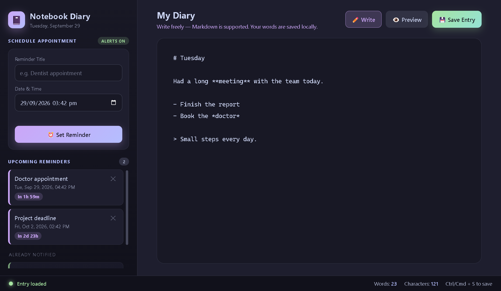
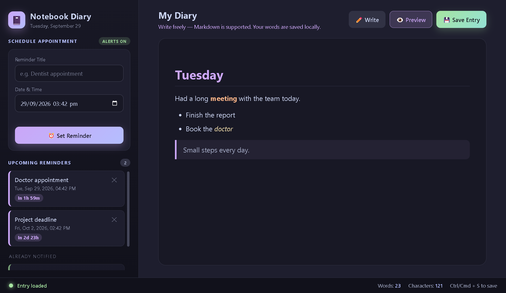

# 📓 Notebook Diary

A private desktop diary for Windows with **autosave**, **Markdown preview** and **native reminder notifications**. Everything is stored locally on your computer. There are no accounts, no cloud and no tracking.





## Features

- **Autosave.** Your entry is saved one second after you stop typing. `Ctrl+S` or **Save Entry** saves immediately.
- **Markdown support.** Write with `# headings`, `**bold**`, `*italic*`, `~~strike~~`, `` `code` ``, lists, quotes and links, then flip to **Preview** to see it rendered. HTML typed into an entry is escaped, never executed.
- **Reminders.** Schedule appointments with a title and a date/time. They are sorted chronologically, show a live countdown, and fire a native Windows notification (plus an in-app banner) exactly once when they are due.
- **Smart title fill.** Click the *Reminder Title* box while it is empty and the app scans your diary for words like *meeting, deadline, call, appointment, doctor, interview, schedule* and pre-fills the first one it finds (e.g. `meeting` → `Meeting`).
- **Live word and character counts**, and a status bar that shows when you are typing, saved, or if saving failed.
- **Private by design.** Data lives in the app's local storage (`my_diary_text` and `my_diary_reminders`). The window runs sandboxed with context isolation and no Node access.

## Install (Windows)

1. Build the installer (see below) to get `Notebook-Diary-Setup-1.0.0.exe`.
2. Run it, choose an install folder, and finish the wizard. It adds Desktop and Start Menu shortcuts.
3. Windows may show *"Windows protected your PC"* because the installer is not code-signed. Click **More info → Run anyway**.

## Run from source

Requires [Node.js](https://nodejs.org/) 18 or newer.

```bash
npm install
npm start
```

> **Note:** if the app crashes with `Cannot read properties of undefined (reading 'setAppUserModelId')`, your terminal has `ELECTRON_RUN_AS_NODE=1` set (VS Code does this). Clear it (`Remove-Item Env:ELECTRON_RUN_AS_NODE` in PowerShell) and run again.

## Build the installer

```bash
npm run dist
```

The installer is written to `dist/Notebook-Diary-Setup-<version>.exe`.

## Project structure

| File | Purpose |
| --- | --- |
| `main.js` | Electron main process: window, single-instance lock, notification permission |
| `index.html` | The entire UI, styling and app logic (no dependencies) |
| `package.json` | Scripts and electron-builder (NSIS) configuration |
| `docs/` | Screenshots used in this README |

## Tech

Electron 33 · plain HTML, CSS and JavaScript · electron-builder (NSIS installer)

## License

[MIT](LICENSE)
